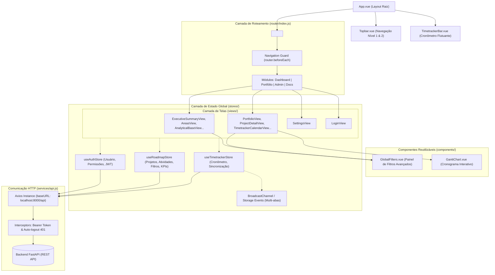
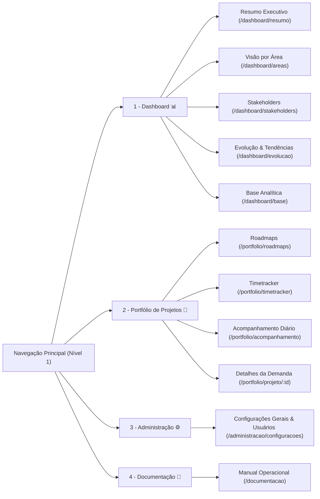

# 🎨 Documentação Técnica do Frontend - RoadMap Corporate Monitor

Esta documentação fornece uma visão aprofundada da arquitetura, ecossistema de componentes, gerenciamento de estado reativo com **Pinia**, roteamento com **Vue Router 4**, sistema de sincronização em tempo real do **Timetracker** e o catálogo completo de telas da SPA (**Single Page Application**) do **RoadMap Corporate Monitor**.

---

## 1. Visão Geral & Tecnologias

O frontend do **RoadMap Corporate Monitor** é uma aplicação web de página única (SPA) moderna, rápida e altamente reativa construída sobre o ecossistema oficial do **Vue 3**. Utiliza **Vite** para compilação instantânea em desenvolvimento e empacotamento otimizado para produção.

### 🛠️ Stack Tecnológica

| Componente | Tecnologia / Biblioteca | Função Principal |
| :--- | :--- | :--- |
| **Framework Base** | [Vue 3](https://vuejs.org/) (v3.5+) | Framework reativo utilizando Composition API e `<script setup>` |
| **Build Tool & Bundler** | [Vite](https://vitejs.dev/) (v6.1+) | Servidor de desenvolvimento rápido via ESM e bundler com Rollup |
| **Gerenciamento de Estado** | [Pinia](https://pinia.vuejs.org/) (v2.3+) | Store centralizada e reativa com tipagem e suporte a DevTools |
| **Roteamento SPA** | [Vue Router](https://router.vuejs.org/) (v4.5+) | Navegação cliente com histórico HTML5, lazy loading e Guards |
| **Cliente HTTP** | [Axios](https://axios-http.com/) (v1.7+) | Requisições REST com interceptors para injeção de JWT e tratamento de 401 |
| **Sincronização em Tempo Real** | BroadcastChannel API + Web Storage | Sincronização multi-abas e persistência de cronômetro em tempo real |
| **UI Components (Branch Dev)** | [PrimeVue 4](https://primevue.org/) | Biblioteca corporativa de componentes (DataTables, Dialogs, Toasts, etc.) |

---

## 2. Arquitetura e Camadas da Aplicação

A arquitetura do frontend é estruturada em camadas bem definidas, garantindo separação entre controle de tela, regras de negócio e consumo de serviços REST:



---

## 3. Estrutura de Diretórios (`src/`)

```text
frontend/src/
├── assets/
│   └── main.css                  # Variáveis CSS globais, tema corporativo e responsividade
├── components/
│   ├── GanttChart.vue            # Gráfico de Gantt interativo para visualização de cronogramas
│   ├── GlobalFilters.vue         # Painel de filtros avançados com busca e multiseleção
│   ├── TimetrackerBar.vue        # Barra flutuante de controle do cronômetro em tempo real
│   └── Topbar.vue                # Cabeçalho global com menu de 2 níveis, perfil e logout
├── router/
│   └── index.js                  # Configuração de rotas, aliases, metadados e Navigation Guards
├── services/
│   └── api.js                    # Instância do Axios com interceptors de autenticação e erro
├── stores/
│   ├── auth.js                   # Store de autenticação, login, logout e permissões (RBAC)
│   ├── roadmap.js                # Store de projetos, entregáveis, atividades, filtros e KPIs
│   └── timetracker.js            # Store do cronômetro ativo, polling e sincronização multi-abas
├── views/
│   ├── AnalyticalBaseView.vue    # Tabela analítica geral de projetos e demandas
│   ├── AreasView.vue             # Visão analítica agrupada por Áreas/Clientes solicitantes
│   ├── DocumentationView.vue     # Manual do usuário e glossário corporativo integrado
│   ├── EvolutionView.vue         # Gráficos de tendências e evolução temporal de entregas
│   ├── ExecutiveSummaryView.vue  # Painel executivo com cartões de KPIs e gráficos de status
│   ├── LoginView.vue             # Tela de autenticação com validação de credenciais
│   ├── PortfolioView.vue         # Visão de Roadmaps em lista e Gantt com criação de projetos
│   ├── ProjectDetailView.vue     # Visão 360° da demanda com tarefas, prazos e horas da equipe
│   ├── SettingsView.vue          # Administração de usuários, permissões e cadastro de áreas
│   ├── StakeholdersView.vue      # Análise de carga de trabalho por gestores e responsáveis
│   ├── TimetrackerCalendarView.vue # Acompanhamento semanal de horas estilo calendário vertical
│   └── TimetrackerView.vue       # Painel individual de apontamentos manuais e histórico
├── App.vue                       # Componente raiz, orquestrador de inicialização de stores
└── main.js                       # Bootstrap da aplicação (criação da app Vue, Pinia e Router)
```

---

## 4. Identidade Visual & Design System

O projeto adota uma identidade visual corporativa moderna com paleta de cores balanceada, contraste acessível e suporte a densidade responsiva ajustada por *viewport*:

### Paleta de Cores (`src/assets/main.css`)

| Variável CSS | Cor Hexadecimal | Finalidade no Sistema |
| :--- | :--- | :--- |
| `--purple` | `#3E2666` | Cor primária institucional (barras de navegação, cabeçalhos, botões principais) |
| `--purple2` | `#6D56A0` | Cor secundária (ícones de apoio, sub-menus, estados hover) |
| `--purple3` | `#EEEAF5` | Fundo de destaque suave (badges, tags e seleções) |
| `--pink` | `#ED1E81` | Cor de ênfase e ação (cronômetro ativo, botões de ação e alertas) |
| `--green` | `#50C878` | Status de Sucesso e demandas `"Concluído"` |
| `--greenbg` | `#F0FDF4` | Fundo suave de cards e badges com sucesso |
| `--yellow` | `#D69A00` | Status de Atenção e demandas `"Em Andamento"` |
| `--red` | `#D84A58` | Alertas de atraso (`is_delayed`), prioridade `"Crítica"` e botões de exclusão |
| `--blue` | `#4F76C7` | Informações neutras, prioridade `"Normal"` e links analíticos |
| `--bg` | `#F5F6FA` | Fundo geral da aplicação (*off-white* para menor fadiga visual) |
| `--card` | `#FFFFFF` | Fundo de cartões, modais e containers |
| `--text` | `#302A36` | Tipografia principal (alto contraste legível) |
| `--muted` | `#756C7E` | Textos secundários, legendas e rótulos de apoio |
| `--line` | `#E8E4ED` | Bordas e divisores estruturais sutis |

### Tipografia e Breakpoints Responsivos

A tipografia base (`html { font-size }`) se calibra dinamicamente de acordo com a resolução do monitor:
- **Notebooks 14"/15" (1360px+)**: `14.0px`
- **Monitores Full HD 24"/27" (1680px+)**: `14.5px`
- **Monitores Ultra-Wide / 2K / 4K (2200px+)**: `15.5px`

---

## 5. Roteamento & Navegação em Dois Níveis

O sistema de rotas (`src/router/index.js`) organiza a aplicação em **4 Módulos Principais (Nível 1)** e **Sub-Navegação Contextual (Nível 2)** renderizada no componente `Topbar.vue`.



### Tabela de Rotas e Permissões

| Rota (Path) | Alias | Nome | Módulo (Nível 1) | Restrição / Permissão |
| :--- | :--- | :--- | :--- | :--- |
| `/login` | - | `login` | Autenticação | Pública (`meta.public: true`) |
| `/dashboard/resumo` | `/resumo`, `/dashboard`, `/` | `dashboard-resumo` | Dashboard | Autenticado |
| `/dashboard/areas` | `/areas` | `dashboard-areas` | Dashboard | Autenticado |
| `/dashboard/stakeholders` | `/stakeholders` | `dashboard-stakeholders` | Dashboard | Autenticado |
| `/dashboard/evolucao` | `/evolucao` | `dashboard-evolucao` | Dashboard | Autenticado |
| `/dashboard/base` | `/base` | `dashboard-base` | Dashboard | Autenticado |
| `/portfolio/roadmaps` | `/portfolio`, `/roadmaps` | `portfolio-roadmaps` | Portfólio | Autenticado |
| `/portfolio/projeto/:id` | `/projeto/:id` | `portfolio-projeto-detail` | Portfólio | Autenticado |
| `/portfolio/timetracker` | `/timetracker` | `portfolio-timetracker` | Portfólio | Autenticado |
| `/portfolio/acompanhamento`| `/acompanhamento`, `/timetracker/calendario` | `portfolio-acompanhamento` | Portfólio | Autenticado |
| `/administracao/configuracoes` | `/configuracoes`, `/administracao` | `admin-configuracoes` | Administração | **Apenas Administrador** (`meta.adminOnly: true`) |
| `/documentacao` | `/docs` | `documentacao` | Documentação | Autenticado |

### Proteção de Rotas (`Navigation Guard`)

A função `router.beforeEach` intercepta todas as transições de rota:
1. Se a rota não for pública e o usuário não possuir token válido, redireciona imediatamente para `/login`.
2. Se o usuário já autenticado tentar acessar `/login`, redireciona para `/dashboard/resumo`.
3. Se a rota exigir privilégios de administrador (`meta.adminOnly: true`) e o perfil do usuário não for `admin`, redireciona para a página inicial com segurança.

---

## 6. Gerenciamento de Estado Global (Pinia Stores)

A aplicação centraliza seus estados em três stores especializadas do **Pinia**:

---

### 1. `useAuthStore` (`src/stores/auth.js`)
Responsável pelo ciclo de vida da sessão do usuário e permissões:

- **State**:
  - `user`: Objeto com informações do usuário logado (`id`, `name`, `email`, `role`, `manager_id`, `manager_name`).
  - `token`: Token JWT armazenado em `localStorage`.
  - `loading` & `error`: Estados de carregamento e mensagens de falha.
- **Getters**:
  - `isAuthenticated`: `true` se existe token ativo.
  - `isAdmin`: Valida se `role === 'admin'`.
  - `isGestor`: Valida se `role === 'gestor'`.
  - `isAnalista`: Valida se `role === 'analista'`.
  - `roleLabel`: Nome legível do perfil (*"Administrador"*, *"Gestor"*, *"Analista"*).
- **Actions**:
  - `login(email, password)`: Envia requisição com `x-www-form-urlencoded` para `/api/auth/login`, grava o token e chama `fetchMe()`.
  - `fetchMe()`: Obtém dados cadastrais atualizados via `/api/users/me` e inicializa o cronômetro pessoal do usuário.
  - `logout()`: Limpa tokens do `localStorage`, interrompe cronômetros em execução e reseta o estado da aplicação.

---

### 2. `useRoadmapStore` (`src/stores/roadmap.js`)
Responsável pela coleção de dados de negócios, cruzamento de filtros e cálculo de indicadores executivos:

- **State**:
  - Coleções: `projects`, `deliverables`, `activities`, `areas`, `users`.
  - `filters`: Estrutura de filtros globais multiseleção:
    - `search`: Busca textual simultânea em nome do projeto, solicitante, chamado, área e responsável.
    - `areas`, `status`, `owners`, `priority`, `requesters`, `technicalResponsibles`, `managers`: Arrays com seleções múltiplas.
    - `delays` / `deadline`: Filtro de prazos (`all`, `overdue`, `ontime`, `completed`).
    - `projectStart`, `projectEnd`, `activityStart`, `activityEnd`: Intervalos de datas.
- **Getters Reativos**:
  - `filteredProjects`: Aplica os 11 critérios de filtros simultâneos. Cruza automaticamente com os responsáveis e períodos das atividades filhas.
  - `filteredActivities`: Filtra atividades pertencentes apenas aos projetos validados e aplica filtros específicos de responsáveis técnicos e períodos.
  - `filteredDeliverables`: Filtra entregáveis pertencentes aos projetos e tarefas ativos.
  - `kpis`: Computa métricas em tempo real para os painéis executivos:
    - Total de Projetos, Concluídos e Percentual (`concProjPct`).
    - Projetos Atrasados (`delayedProjects`).
    - Total de Atividades, Concluídas (`completedActivities`), Pendentes e Percentual (`concAtivPct`).
    - Atividades Atrasadas (`delayedActivities`).
    - Horas e Minutos Totais Apontados (`totalTrackedHours`).
- **Actions**:
  - `fetchAll()`: Carrega em paralelo (`Promise.all`) projetos, entregáveis, atividades, áreas e usuários da API.
  - `createProject()`, `updateProject()`: Operações de persistência com sincronização da store local.
  - `createActivity()`, `updateActivity()`, `deleteActivity()`: Persistência de tarefas com recarregamento das métricas pai.

---

### 3. `useTimetrackerStore` (`src/stores/timetracker.js`)
Controla o cronômetro em tempo real, persistência local e sincronização distribuída entre janelas:

- **Mecanismos de Sincronização em Tempo Real**:
  1. **Tick por Segundo (`startTickInterval`)**: Calcula o tempo decorrido comparando `Date.now() - activeTimer.startTime` para evitar distorções de tempo por suspensão da aba.
  2. **BroadcastChannel API (`roadmap_timetracker_channel`)**: Comunicação instantânea (0ms) entre todas as abas abertas do mesmo navegador. Se o usuário inicia o cronômetro na aba A, a barra flutuante da aba B começa a rodar no mesmo milissegundo.
  3. **Storage Event Listener**: Fallback para navegadores que não suportam BroadcastChannel.
  4. **Polling de Liveness (`startBackgroundPoller`)**: Consulta a API (`/api/timetracker/active`) a cada 3.5 segundos para detectar alterações feitas em outros computadores ou navegadores anônimos.
- **Getters**:
  - `isTimerRunning`: Booleano indicando execução ativa.
  - `formattedTimer`: Formato `HH:MM:SS` com preenchimento de zeros à esquerda.
  - `totalTrackedMinutes` & `totalTrackedHours`: Soma total de tempo registrado.
- **Actions**:
  - `startTimer(activityId)`: Chama `POST /api/timetracker/start`, persiste em storage e dispara broadcast.
  - `stopTimer(description)`: Chama `POST /api/timetracker/stop`, salva o apontamento e zera o contador.
  - `fetchMyEntries()`: Lista o histórico pessoal de horas apontadas.

---

## 7. Componentes Globais e Reutilizáveis

### `Topbar.vue` (`src/components/Topbar.vue`)
- **Nível 1 (Módulos)**: Botões de navegação para *Dashboard*, *Portfólio de Projetos*, *Administração* e *Documentação*.
- **Badge Pulsante de Cronômetro**: Se houver um cronômetro rodando, exibe uma tag rosa piscante com a contagem de tempo em tempo real direto na aba do Portfólio.
- **Identificação do Usuário**: Exibe o nome completo, o perfil formatado (*"Administrador"*, *"Gestor"*, etc.) e o botão de encerramento de sessão (*Sair*).
- **Nível 2 (Sub-Abas Contextuais)**: Renderiza automaticamente as páginas pertencentes ao módulo selecionado sem recarregar a tela.

### `TimetrackerBar.vue` (`src/components/TimetrackerBar.vue`)
- Barra fixada no topo da interface quando o usuário está autenticado.
- Permite selecionar uma atividade de qualquer projeto através de um dropdown com busca.
- Botões de início rápido (**▶ Iniciar**), parada com inserção de descrição (**⏹ Parar**) e botão de apontamento manual direto.
- Exibe o tempo corrente em destaque (`00:00:00`).

### `GlobalFilters.vue` (`src/components/GlobalFilters.vue`)
- Painel sanfonado e expansível de filtros reutilizado no Dashboard e no Portfólio de Projetos.
- **Recursos Avançados**:
  - Campo de busca global com limpeza rápida.
  - Dropdowns multiseleção personalizados com busca interna, botão *"Marcar Todos"* e *"Limpar"*.
  - Filtro exclusivo de atrasos e prazos (*Todos*, *Em Atraso*, *Em Dia*, *Concluídos*).
  - Intervalos duplos de datas (datas de projeto e datas de atividades).
  - Botão de *"Limpar Todos os Filtros"* que restaura o estado padrão em um único clique.

### `GanttChart.vue` (`src/components/GanttChart.vue`)
- Componente de visualização temporal de cronogramas.
- Calcula a escala de dias e semanas automaticamente a partir do menor início e maior término das atividades.
- Exibe barras coloridas com o progresso percentual preenchido internamente e alerta visual para itens em atraso.

---

## 8. Catálogo Completo de Telas (Views)

---

### 📊 Módulo 1: Dashboard

#### 1. `ExecutiveSummaryView.vue` (`/dashboard/resumo`)
- **Objetivo**: Visão executiva consolidada de alto nível para tomada de decisão.
- **Destaques**:
  - Cartões de KPIs principais: Total de Projetos, Concluídos, Atrasados, Entregáveis, Atividades Concluídas vs. Pendentes e Horas Totais Trabalhadas.
  - Gráficos de distribuição de projetos por Situação (*Não Iniciado*, *Em Andamento*, *Concluído*, *Pausado*).
  - Gráficos de distribuição por Prioridade (*Baixa*, *Normal*, *Alta*, *Crítica*).
  - Listagem dos projetos mais críticos e com prazos iminentes.

#### 2. `AreasView.vue` (`/dashboard/areas`)
- **Objetivo**: Análise do portfólio agrupada por Área de Negócio ou Cliente solicitante.
- **Destaques**:
  - Comparativo de volume de projetos e atividades por área.
  - Taxa percentual de conclusão por setor demandante.
  - Total de horas investidas em cada departamento.

#### 3. `StakeholdersView.vue` (`/dashboard/stakeholders`)
- **Objetivo**: Mapeamento de carga de trabalho e responsabilidades.
- **Destaques**:
  - Visão por **Solicitante**: quem mais demanda novos projetos.
  - Visão por **Gestor Imediato**: acompanhamento de lideranças e suas equipes.
  - Visão por **Responsável Técnico**: identificação de gargalos individuais e distribuição de tarefas entre analistas.

#### 4. `EvolutionView.vue` (`/dashboard/evolucao`)
- **Objetivo**: Curvas de tendência e evolução histórica.
- **Destaques**:
  - Análise temporal de entregas ao longo dos meses.
  - Comparativo entre datas previstas e conclusão real.

#### 5. `AnalyticalBaseView.vue` (`/dashboard/base`)
- **Objetivo**: Base tabular analítica completa com visão detalhada de ponta a ponta.
- **Destaques**:
  - Tabela com todas as colunas de dados (Projeto, Área, Solicitante, Gestor, Responsável, Datas, Progresso e Horas).
  - Paginação, ordenação por cabeçalho e compatibilidade com os filtros globais.

---

### 📁 Módulo 2: Portfólio de Projetos

#### 1. `PortfolioView.vue` (`/portfolio/roadmaps`)
- **Objetivo**: Centro de gerenciamento das demandas e visão de Roadmap.
- **Destaques**:
  - Alternância de visualização entre **Cards de Demanda** e **Gráfico de Gantt Integrado**.
  - Botão de criação de nova demanda com modal intuitivo de cadastro.
  - Visualização hierárquica expansível: Projeto ➔ Entregáveis ➔ Atividades.
  - Acesso direto com um clique aos detalhes e cronômetro de cada atividade.

#### 2. `ProjectDetailView.vue` (`/portfolio/projeto/:id`)
- **Objetivo**: Visão 360° aprofundada de uma demanda específica.
- **Destaques**:
  - Cabeçalho com metadados: Solicitante, Número do Chamado, Área, Gestor, Datas e Barra de Progresso Geral.
  - **Aba de Estrutura**: Gerenciamento de Entregáveis e criação/edição de Atividades.
  - **Aba de Cronograma**: Gantt individual do projeto.
  - **Aba de Gestão de Horas / Equipe**: Total de horas apontadas na demanda, gráfico de percentual de dedicação por membro da equipe e tabela detalhada de todos os lançamentos com observações.

#### 3. `TimetrackerView.vue` (`/portfolio/timetracker`)
- **Objetivo**: Central individual do colaborador para apontamento e controle de horas.
- **Destaques**:
  - Cartão de controle do cronômetro com seleção de tarefa e observações.
  - Formulário para lançamento de horas retroativas manuais.
  - Tabela com o histórico dos próprios apontamentos do usuário logado e totalizadores de horas do dia e da semana.

#### 4. `TimetrackerCalendarView.vue` (`/portfolio/acompanhamento`)
- **Objetivo**: Acompanhamento diário e semanal de esforço no formato de calendário vertical.
- **Destaques**:
  - Disposição semanal em **7 colunas verticais** (Segunda-feira a Domingo).
  - Cabeçalho de cada dia destacando a data e a **soma total de horas** apontadas no dia.
  - Caixinhas individuais de atividades dentro do dia exibindo: tempo gasto, nome do colaborador, projeto e descrição da tarefa.
  - Controles de navegação temporal: botões de **"Semana Anterior"**, **"Semana Atual"** e **"Próxima Semana"**.
  - **Filtro Avançado por Colaborador**: dropdown customizado com pesquisa interna, opções de *"Marcar Todos"*, *"Limpar"* e seleção múltipla para gestores e administradores visualizarem o esforço de analistas específicos.

---

### ⚙️ Módulo 3: Administração

#### 1. `SettingsView.vue` (`/administracao/configuracoes`)
- **Objetivo**: Gestão de acessos e configurações corporativas (Restrito ao perfil `admin`).
- **Destaques**:
  - **Gestão de Usuários**: Cadastro de novos membros, alteração de cargos (`admin`, `gestor`, `analista`), definição da hierarquia de gestores (`manager_id`) e redefinição de senhas.
  - **Gestão de Áreas / Clientes**: Criação, edição de nomenclatura e exclusão de áreas corporativas.

---

### 📘 Módulo 4: Documentação

#### 1. `DocumentationView.vue` (`/documentacao`)
- **Objetivo**: Manual de uso interativo e padronização operacional.
- **Destaques**:
  - Guia de navegação nos módulos.
  - Glossário corporativo com a definição oficial de cada status (*Não Iniciado*, *Em Andamento*, *Concluído*, *Pausado*, etc.).
  - Boas práticas para apontamento de horas e gestão de entregáveis.

---

### 🔐 Autenticação

#### 1. `LoginView.vue` (`/login`)
- Formulário minimalista de login corporativo com validação de campos.
- Exibição de mensagens de erro claras (*"Credenciais incorretas"*).
- Redirecionamento automático após autenticação para o Dashboard.

---

## 9. Comunicação HTTP com a API (`src/services/api.js`)

O cliente HTTP Axios é centralizado em `src/services/api.js`:

```javascript
import axios from 'axios'

const api = axios.create({
  baseURL: 'http://localhost:8000/api',
  timeout: 15000,
})

// Request Interceptor: Injeta o token Bearer JWT caso exista
api.interceptors.request.use((config) => {
  const token = localStorage.getItem('roadmap_token')
  if (token) {
    config.headers.Authorization = `Bearer ${token}`
  }
  return config
})

// Response Interceptor: Trata erro 401 (desloga e redireciona se expirado)
api.interceptors.response.use(
  (response) => response,
  (error) => {
    if (error.response && error.response.status === 401) {
      localStorage.removeItem('roadmap_token')
      localStorage.removeItem('roadmap_user')
      if (window.location.pathname !== '/login') {
        window.location.href = '/login'
      }
    }
    return Promise.reject(error)
  }
)
```

---

## 10. Como Executar e Compilar o Frontend

### Pré-requisitos
- **Node.js** versão 18.0 ou superior instalada.
- **npm** (ou yarn/pnpm).
- O backend FastAPI deve estar rodando na porta `8000`.

### Passo a Passo

1. **Acessar a pasta do frontend**:
   ```bash
   cd frontend
   ```

2. **Instalar as dependências**:
   ```bash
   npm install
   ```

3. **Iniciar o servidor de desenvolvimento (Vite)**:
   ```bash
   npm run dev
   ```
   > A aplicação estará acessível em: `http://localhost:5173/`

4. **Gerar a compilação de produção**:
   ```bash
   npm run build
   ```
   > Os arquivos estáticos otimizados e minificados serão gerados na pasta `frontend/dist/`.

5. **Testar a compilação de produção localmente**:
   ```bash
   npm run preview
   ```

